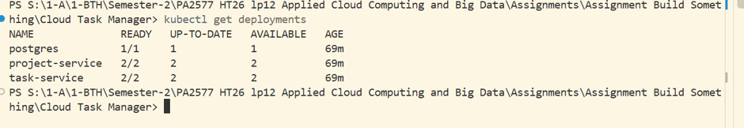
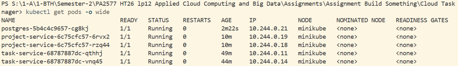
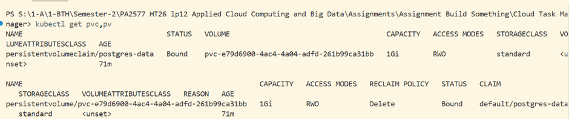
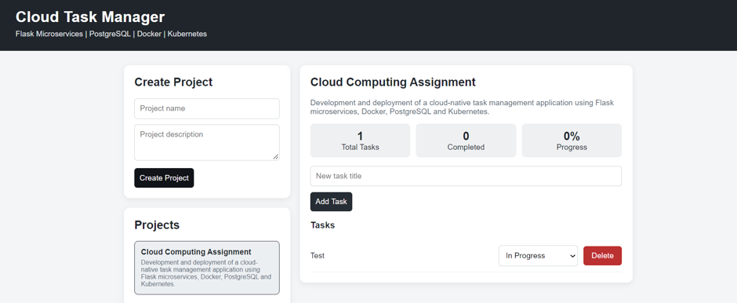

# Cloud Task Manager

A cloud-native task management application built as a student project using **Python Flask microservices, PostgreSQL, Docker, and Kubernetes**.

The project demonstrates REST APIs, containerization, service-to-service communication, independent horizontal scaling, Kubernetes orchestration, and persistent database storage.

## 1. Project Overview

Cloud Task Manager provides a browser-based interface for creating projects, managing tasks, updating task statuses, deleting tasks, and monitoring project progress.

The application contains **two independently deployable and scalable microservices**:

- **Project Service:** Manages projects, serves the web interface, and forwards task-related browser requests to the Task Service.
- **Task Service:** Manages task creation, retrieval, status updates, and deletion.

Both services connect to a PostgreSQL database deployed in the Kubernetes cluster. The browser accesses the application through the Project Service; the Task Service is reached through an internal Kubernetes Service.

## 2. Technologies

| Technology | Purpose |
|---|---|
| Python | Backend application logic |
| Flask | REST API implementation |
| SQLAlchemy and psycopg | Database access |
| PostgreSQL | Relational data storage |
| Docker | Container images |
| Docker Hub | Image registry |
| Kubernetes | Deployment, networking, and scaling |
| Minikube | Local Kubernetes environment |
| HTML, CSS, JavaScript | Browser-based user interface |
| Git and GitHub | Version control and source hosting |

## 3. Architecture

```text
                         Web Browser
                              |
                              v
                 Project Service (Flask)
                     Port 5000 / UI
                    /             \
                   v               v
         PostgreSQL Service    Task Service (Flask)
              Port 5432            Port 5001
                                      |
                                      v
                               PostgreSQL Service
                                   Port 5432
```

The **Project Service** exposes the web interface and project REST endpoints. Its `/tasks-api/` route forwards browser requests to the **Task Service**, which exposes task REST endpoints. Both services access the same PostgreSQL instance.

Kubernetes Services provide stable names and route traffic to available application Pods. The PostgreSQL files are stored using a PersistentVolumeClaim (PVC).

> **Scope:** This is a local educational demonstration. The two microservices are separately deployed and scaled, but they share a database, which creates coupling and a common availability dependency.

## 4. Repository Structure

```text
cloud-task-manager/
├── kubernetes/
│   └── app.yaml
├── project-service/
│   ├── app.py
│   ├── Dockerfile
│   ├── requirements.txt
│   └── templates/
│       └── index.html
├── task-service/
│   ├── app.py
│   ├── Dockerfile
│   └── requirements.txt
├── screenshots/
│   ├── 01-kubernetes-deployments.png
│   ├── 02-kubernetes-pods.png
│   ├── 03-postgresql-persistent-storage.png
│   └── 04-cloud-task-manager-ui.png
├── .gitignore
└── README.md
```

The `screenshots/` folder contains evidence from the running Minikube deployment.

## 5. Application Features and REST APIs

**Browser features:**

- Create and view projects.
- Add tasks to a selected project.
- Change task status between **Pending**, **In Progress**, and **Completed**.
- Delete tasks.
- View total tasks, completed tasks, and percentage progress.

### Project Service

| Method | Endpoint | Description |
|---|---|---|
| GET | `/` | Display the web interface |
| GET | `/health` | Readiness endpoint |
| GET | `/api/projects` | List projects |
| POST | `/api/projects` | Create a project |
| GET | `/api/projects/<id>/summary` | Retrieve project summary |
| Various | `/tasks-api/<path>` | Forward task API requests to the Task Service |

### Task Service

| Method | Endpoint | Description |
|---|---|---|
| GET | `/health` | Readiness endpoint |
| GET | `/api/tasks` | List tasks (optionally filtered by project) |
| POST | `/api/tasks` | Create a task |
| PUT | `/api/tasks/<id>` | Update a task |
| DELETE | `/api/tasks/<id>` | Delete a task |

## 6. Docker Images

Two custom application images are published to Docker Hub:

| Service | Image |
|---|---|
| Project Service | `v2sumac/cloud-project-service:1.2` |
| Task Service | `v2sumac/cloud-task-service:1.2` |

Build the images from the repository root:

```powershell
docker build -t v2sumac/cloud-project-service:1.2 ./project-service
docker build -t v2sumac/cloud-task-service:1.2 ./task-service
```

Push them to Docker Hub (requires permission to publish to the repositories):

```powershell
docker push v2sumac/cloud-project-service:1.2
docker push v2sumac/cloud-task-service:1.2
```

The Kubernetes manifest references these image tags.

## 7. Kubernetes Deployment

All Kubernetes resources are declared in `kubernetes/app.yaml`, except the database password Secret, which must be created separately.

The manifest defines:

- ConfigMap (`task-config`)
- PersistentVolumeClaim (`postgres-data`)
- PostgreSQL Deployment and Service
- Project Service Deployment and NodePort Service
- Task Service Deployment and internal Service

### Prerequisites

- Docker Desktop with its Docker engine running
- Minikube and `kubectl` installed
- Sufficient local CPU and memory
- Access to the published Docker images

### 7.1 Start Minikube

```powershell
minikube start --driver=docker --cpus=2 --memory=3072
kubectl get nodes
```

### 7.2 Create the database Secret

The manifest expects a Kubernetes Secret named `task-db-secret` with the key `POSTGRES_PASSWORD`.

In **PowerShell**, enter a password without saving it in the repository:

```powershell
$DbPassword = Read-Host "Enter a database password"
kubectl create secret generic task-db-secret --from-literal="POSTGRES_PASSWORD=$DbPassword"
Remove-Variable DbPassword
```

Use a password that does not contain URL-special characters for this demonstration, because the current `DATABASE_URL` configuration interpolates the password into a connection string. A production implementation should safely encode credentials or construct the connection parameters separately.

**Important:** On an existing deployment with initialized PostgreSQL data, creating a new Secret with a different password will not automatically change the database user's stored password. Reuse the existing Secret when redeploying the running application.

### 7.3 Apply the Kubernetes manifest

```powershell
kubectl apply -f kubernetes/app.yaml
kubectl get deployments
kubectl get pods
kubectl get services
kubectl get pvc
```

Expected application replica counts in the committed manifest:

| Deployment | Replicas |
|---|---:|
| PostgreSQL | 1 |
| Project Service | 2 |
| Task Service | 2 |

Wait for each Deployment to become ready:

```powershell
kubectl rollout status deployment/postgres --timeout=180s
kubectl rollout status deployment/project-service --timeout=180s
kubectl rollout status deployment/task-service --timeout=180s
```

### 7.4 Access the application

Keep the following command running in a separate terminal:

```powershell
kubectl port-forward svc/project-service 8080:5000
```

Open `http://localhost:8080` in a browser. The Project Service also has a NodePort configuration (`30080`) for cluster-dependent access.

## 8. Independent Horizontal Scaling

The two Flask microservices have separate Kubernetes Deployments, allowing their replica counts to be changed independently.

```powershell
kubectl scale deployment/project-service --replicas=3
kubectl get deployments
kubectl get pods -o wide
```

This increases only the Project Service replicas; the Task Service can remain at two replicas. Restore the baseline configuration:

```powershell
kubectl scale deployment/project-service --replicas=2
```

Both application services were successfully demonstrated with **two ready replicas each**, while PostgreSQL remained at one replica. Kubernetes Services route requests to available Pods.

Scaling increases service capacity and resilience to individual application Pod failure, but does not eliminate the shared database as a possible bottleneck or single point of failure.

## 9. PostgreSQL Persistent Storage

PostgreSQL uses the PersistentVolumeClaim `postgres-data` with the following observed properties:

| Property | Value |
|---|---|
| Capacity | 1 GiB |
| Access mode | ReadWriteOnce (`RWO`) |
| Storage class | `standard` |
| PVC status | `Bound` |
| PV status | `Bound` |

Verify storage:

```powershell
kubectl get pvc,pv
```

### Persistence demonstration

1. Create a project and task in the browser and refresh to verify they were saved.
2. Replace only the PostgreSQL Pod:

   ```powershell
   kubectl delete pod -l app=postgres
   ```

3. Wait until the replacement PostgreSQL Pod is ready:

   ```powershell
   kubectl get pods
   ```

4. Refresh the browser and confirm the existing project and task are still present.

The PVC keeps the database files separate from the lifecycle of the PostgreSQL container. **Do not delete the PVC** during this test: the dynamically provisioned volume uses a `Delete` reclaim policy.

A `Bound` PVC proves storage provisioning; the before-and-after browser check is needed to verify data persistence in practice.

## 10. Cloud-Native Design Principles

| Principle | Implementation |
|---|---|
| Separation of concerns | Project and task operations are implemented in different Flask services |
| Containerization | Each microservice has its own Dockerfile and image |
| Independent deployment | Each application service has its own Kubernetes Deployment |
| Horizontal scaling | Replica counts can be changed independently |
| Service discovery | Internal Kubernetes Services resolve service names |
| Declarative infrastructure | Resources are defined in `kubernetes/app.yaml` |
| Persistent state | PostgreSQL data is stored through a PVC |
| Health awareness | HTTP readiness probes check the application services |
| Self-healing | Kubernetes replaces Pods when a Deployment requires it |

## 11. Benefits

- Independent scaling and updates for the two application services.
- Clear separation between project and task responsibilities.
- Reproducible container images and declarative Kubernetes configuration.
- Service discovery and routing managed by Kubernetes.
- Automated replacement of application and database Pods.
- Database files persist independently of the PostgreSQL Pod lifecycle.

## 12. Challenges and Trade-offs

- **Operational complexity:** Multiple Deployments, Services, images, and environment variables must be configured correctly.
- **Service dependencies:** The Project Service depends on the Task Service for task-related operations.
- **Shared database:** Both services depend on one PostgreSQL instance, which limits isolation and introduces a common failure point.
- **Image management:** Kubernetes must reference image tags that actually exist in the registry.
- **Resource use:** Multiple replicas require additional local CPU and memory.
- **Troubleshooting:** Deployment errors may involve source code, container builds, image publishing, Kubernetes configuration, or database connectivity.

During development, the project encountered and resolved Python syntax errors in an image, missing image tags on Docker Hub, and database connection configuration issues.

## 13. Security Considerations

### Measures implemented

- The PostgreSQL password is provided through a Kubernetes Secret reference rather than being committed in the YAML manifest.
- The application images run the Flask application using a non-root user.
- PostgreSQL and the Task Service are exposed through internal Kubernetes Services, rather than public NodePorts.

### Limitations and production improvements

This is an educational demonstration, **not a production-ready application**. Production deployment would require:

- Authentication and authorization for project/task operations.
- HTTPS/TLS for browser traffic and appropriate protection for internal communication.
- NetworkPolicies restricting Pod-to-Pod access.
- Resource requests, limits, and stronger health/liveness checks.
- Secret rotation and safer credential handling; Kubernetes Secrets are not automatically encrypted at rest in every cluster.
- Image vulnerability scanning and pinned image digests.
- Database backups, recovery procedures, and a more resilient database architecture.
- Monitoring, alerting, and centralized logging.

## 14. Monitoring and Troubleshooting

Useful Kubernetes commands:

```powershell
kubectl get deployments
kubectl get pods -o wide
kubectl get services
kubectl get pvc,pv
kubectl logs deployment/project-service --tail=30
kubectl logs deployment/task-service --tail=30
kubectl logs deployment/postgres --tail=30
```

For a specific failing Pod, use `kubectl describe pod <pod-name>` and `kubectl logs <pod-name> --previous` when appropriate.

## 15. Deployment Evidence and Screenshots

The following screenshots were captured from the working local Kubernetes environment.

### 15.1 Kubernetes Deployments

One PostgreSQL replica and two ready replicas for each Flask microservice demonstrate independent application scaling.



### 15.2 Kubernetes Pods

Five healthy Pods, including two Project Service Pods and two Task Service Pods, demonstrate the deployed service instances.



### 15.3 PostgreSQL Persistent Storage

The PostgreSQL PVC and its associated PV are both `Bound`, with 1 GiB of provisioned storage.



### 15.4 Cloud Task Manager Interface

The browser UI shows the project list, task management controls, and progress statistics.



## 16. Conclusion

Cloud Task Manager demonstrates a browser-based application built from two Flask microservices, PostgreSQL, Docker images, and Kubernetes resources.

The working deployment includes independent horizontal scaling, internal service discovery, readiness checks, browser-accessible functionality, and a provisioned persistent database volume. The project also illustrates the operational and security trade-offs that accompany a microservices-based, cloud-native architecture.
